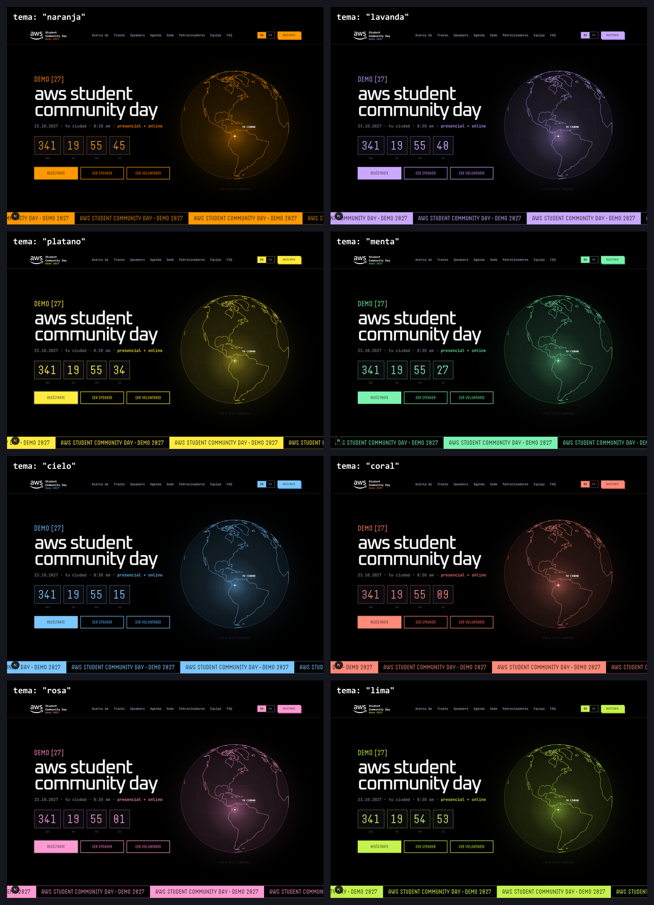

# Community Day Kit

The website, forms and operations panel for a **Student Community Day**, ready
for any community in Latin America to run their own. It grew out of the 2026
Colombia and Chile editions and ships with nothing from either: you describe
your event in one folder and everything else adapts.

[Español](README.md) · the code, comments and docs are in Spanish.



## What you get

- **Public site** in Spanish and English: landing page with a globe pointing at
  your venue, agenda, speakers, sponsors, FAQ, legal pages.
- **Forms** for registration, Call for Speakers and volunteers, with the ID
  documents, phone formats and education levels of 20 countries.
- **Admin panel** with roles and permissions: proposal review, agenda with
  clash detection, QR check-in, badges, certificates, exports.
- **Emails** edited from the panel, with audiences and campaigns (Resend or Amazon SES).
- **Volunteers**: call, selection and certificate.
- **Digital passport**: attendees collect stamps from booths and talks with their QR.
- **Eight colour themes**, or your own derived from a single colour.
- **Machine-readable**: `/llms.txt`, `/llms-full.txt`, `/api/evento` and JSON-LD.

## Try it in two minutes

You only need Node 20.12+. No database, accounts or keys.

```bash
git clone https://github.com/heysebitas/community-day-kit.git
cd community-day-kit
npm install
npm run demo
```

Open <http://localhost:3000>. The panel is at `/admin/login`, with
`demo@example.com` / `demo-demo-demo`. Data lives in memory and is gone when you stop it.

## Set up your event

**With an AI assistant** (Claude Code, Kiro, Codex, Cursor, Copilot…), open the
repo and say:

> Read `docs/asistente.md` and help me set up my event.

**By hand:**

```bash
npm run setup     # asks the basics, writes evento/config.ts and .env.local
npm run doctor    # tells you what is missing
```

Everything about your edition lives in `evento/` and `public/evento/`; `src/`
is the kit. The guides are in [docs/](docs/).

## Contributing

Issues and pull requests are welcome, in Spanish or English:
[CONTRIBUTING.md](CONTRIBUTING.md). Report security problems privately:
[SECURITY.md](SECURITY.md).

## License

[MIT](LICENSE). This is a community project, not an Amazon Web Services product
and not endorsed by AWS. Trademarks belong to their owners and the kit grants
no right to use them; see [NOTICE.md](NOTICE.md).

Made by [Sebastián Acuña](https://github.com/heysebitas).
