# AWS Community Day Kit

El sitio, los formularios y el panel de operación de un **AWS Student
Community Day** o de cualquier **Community Day**, listos para que una
comunidad de Latinoamérica monte el suyo. Es la plataforma con la que se
hicieron los Student Community Days de [Colombia](https://awsstudentcommunity.day),
[Chile](https://scdchile.cl) y [México](https://studentcommunitydaymexico.com/),
sin nada de ninguno de los tres: tu evento se describe en una carpeta y el
resto se adapta.

[English](README.en.md) · [Galería completa](docs/galeria.md) · [Para asistentes de IA](AGENTS.md)

📖 **[Leer el artículo en Builder Center](https://builder.aws.com/content/3MFNZKPLTc1ZpmmkP4orOqqRDvX/la-plataforma-de-los-student-community-days-ahora-es-de-todos)**: la historia de cómo pasó de Colombia a Chile y México, y por qué ahora es de todos.

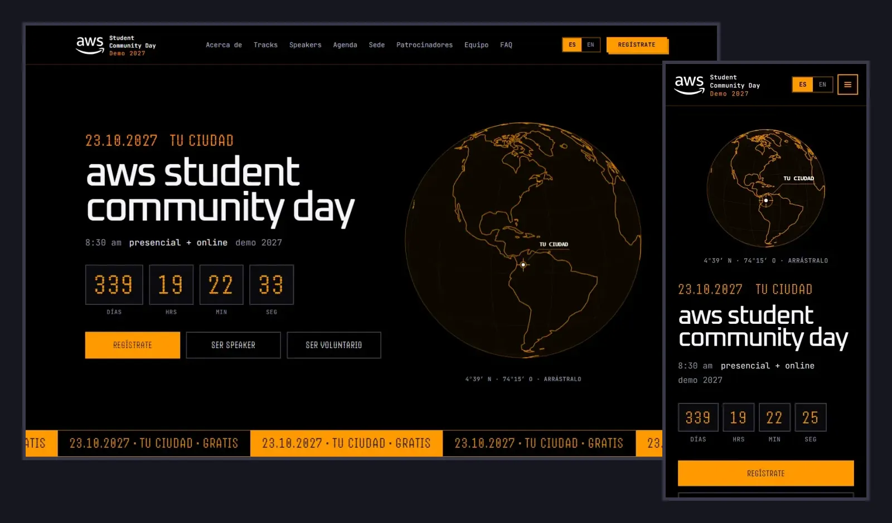

## Pruébalo en dos minutos

Sólo hace falta [Node](https://nodejs.org) 20.19 o más. Ni base de datos, ni
cuentas, ni llaves.

```bash
git clone https://github.com/heysebitas/aws-community-day-kit.git
cd aws-community-day-kit
npm install
npm run demo
```

Abre <http://localhost:3000>. Viene con datos de ejemplo inventados —speakers,
agenda, asistentes, voluntarios— para que todo se vea como el día del evento.

| Para ver | Entra a |
|---|---|
| El panel | `/admin/login` con `demo@example.com` / `demo-demo-demo` |
| Un pasaporte digital | `/pasaporte/demo00000001`, PIN `1234` |
| El sitio en inglés | `/en` |

Los datos viven en memoria y se pierden al cerrar.

## Monta tu evento

### Con un asistente de IA

Abre el repo en Claude Code, Kiro, Codex, Cursor, Copilot o Gemini y pega:

```text
Lee docs/asistente.md y AGENTS.md y ayúdame a configurar mi evento.
```

¿Todavía no lo clonaste? Pásale esto y lo hace por ti:

```text
Clona https://github.com/heysebitas/aws-community-day-kit, lee su
docs/asistente.md y AGENTS.md, y ayúdame a configurar mi evento.
```

Te pregunta lo necesario (país, fecha, sede, colores…), escribe la
configuración, te enseña el sitio funcionando y te deja una lista de lo que
falta. En Claude Code también está el comando `/configurar-evento`.

### A mano

```bash
npm run setup     # pregunta lo básico y escribe evento/config.ts y .env.local
npm run doctor    # dice qué falta
```

Después se completa el contenido en `evento/` (equipo, keynotes,
patrocinadores, tracks) y se despliega con [docs/despliegue.md](docs/despliegue.md).

## Qué trae

### Un sitio que se configura, no se programa

Portada con un globo que señala tu sede, agenda, speakers, patrocinadores,
preguntas frecuentes y textos legales con la ley de datos de tu país. En
español e inglés, y pensado primero para el teléfono.

| | |
|---|---|
| 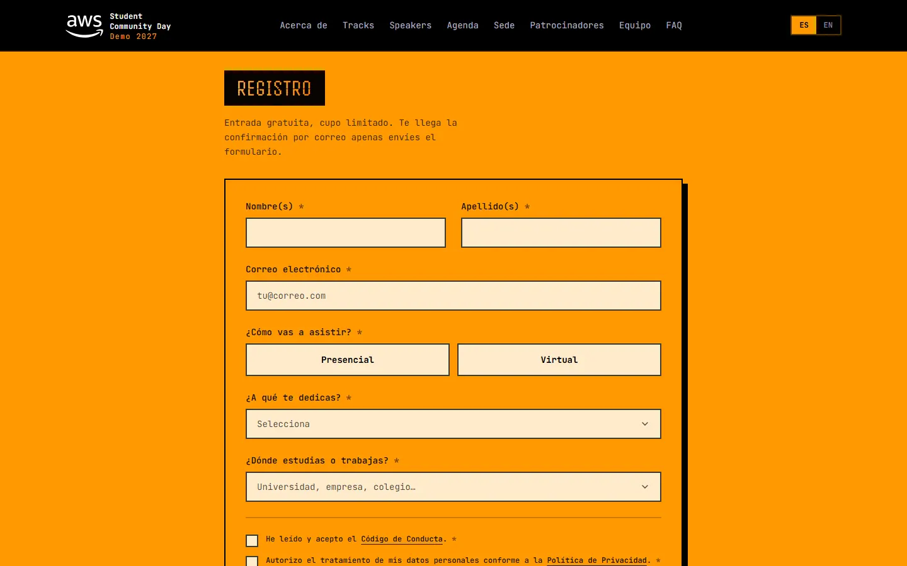 | 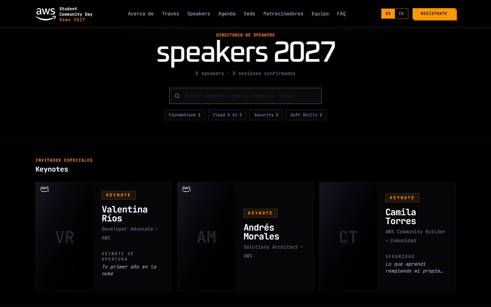 |

### Formularios para cada papel

Registro, Call for Speakers y voluntariado, con los documentos, teléfonos y
niveles de estudio de 20 países. Captcha, validación en el servidor y correo
de confirmación con el pase en QR.

| Registro | Speakers y agenda | Pasaporte |
|---|---|---|
| 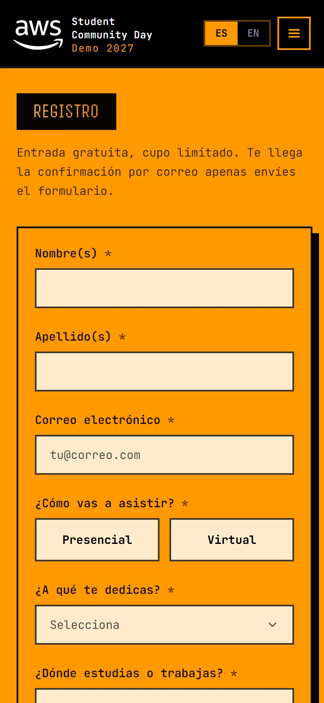 | 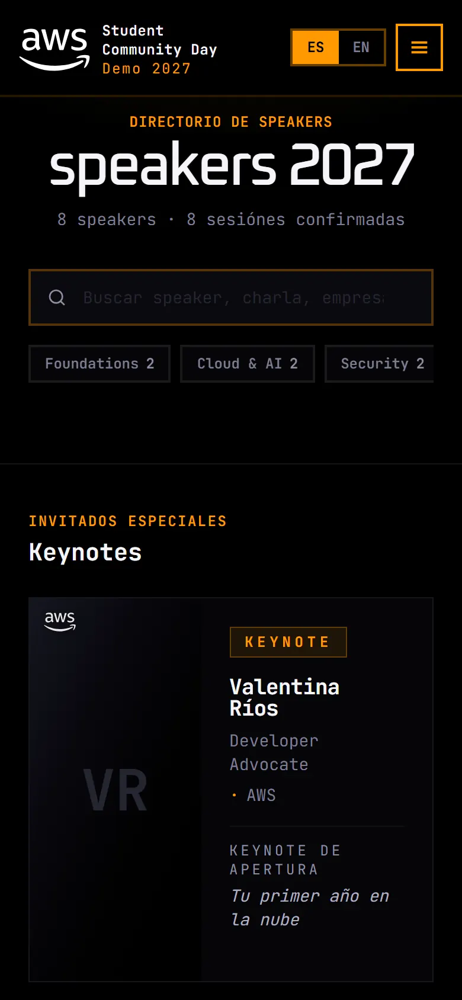 | 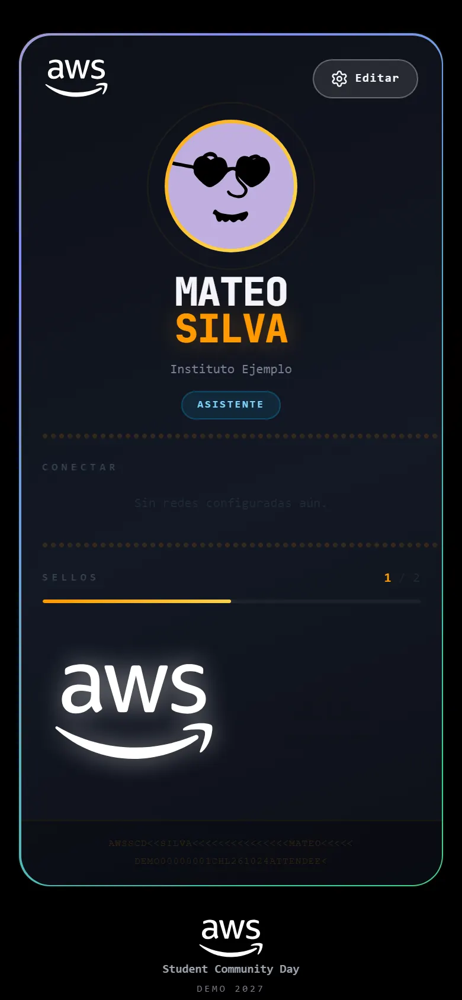 |

### Un panel para el equipo

Revisión de propuestas, agenda por salas con choques marcados, check-in con
QR desde el teléfono, escarapelas, certificados, exportes y un registro de
todo lo que se hace. Cada cuenta ve sólo las secciones que le tocan.

| | |
|---|---|
| 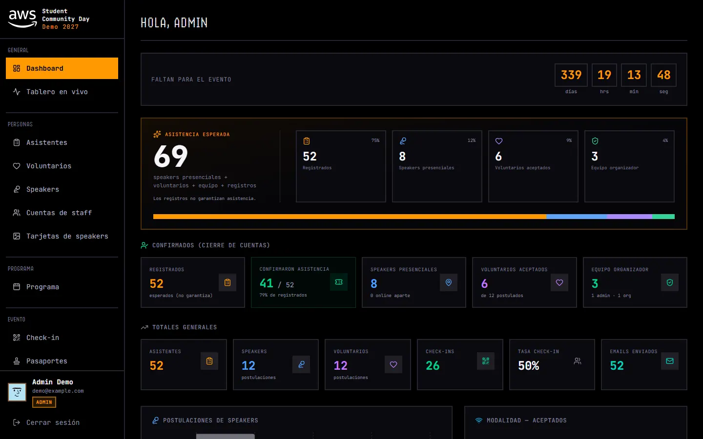 | 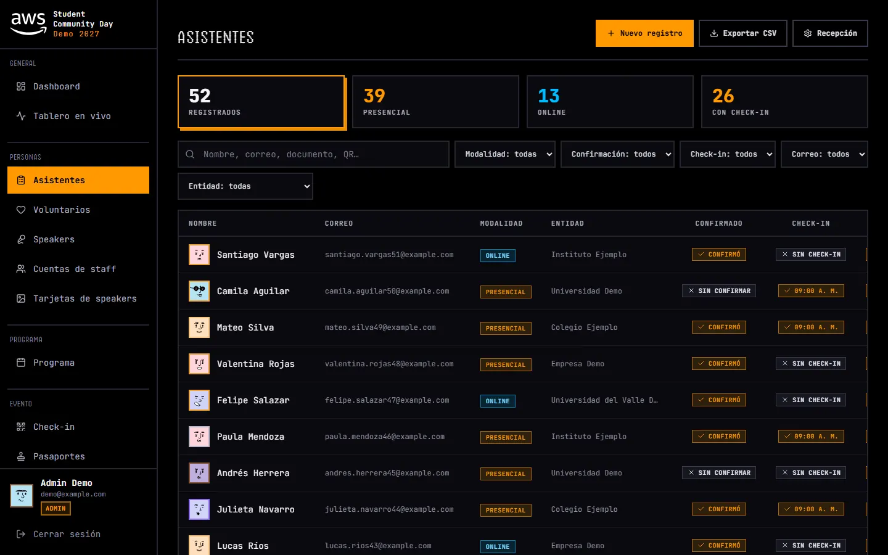 |
| 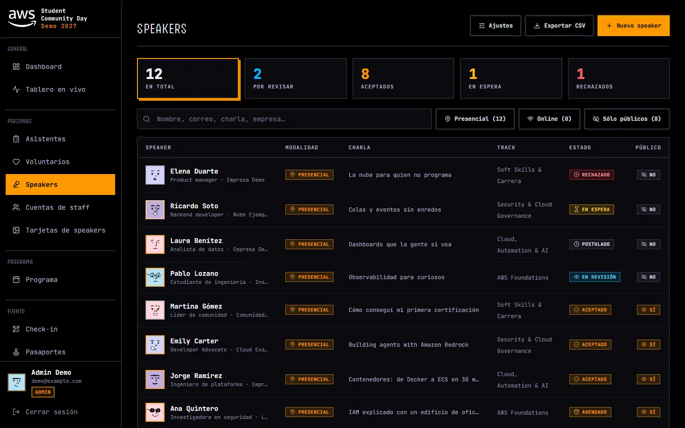 | 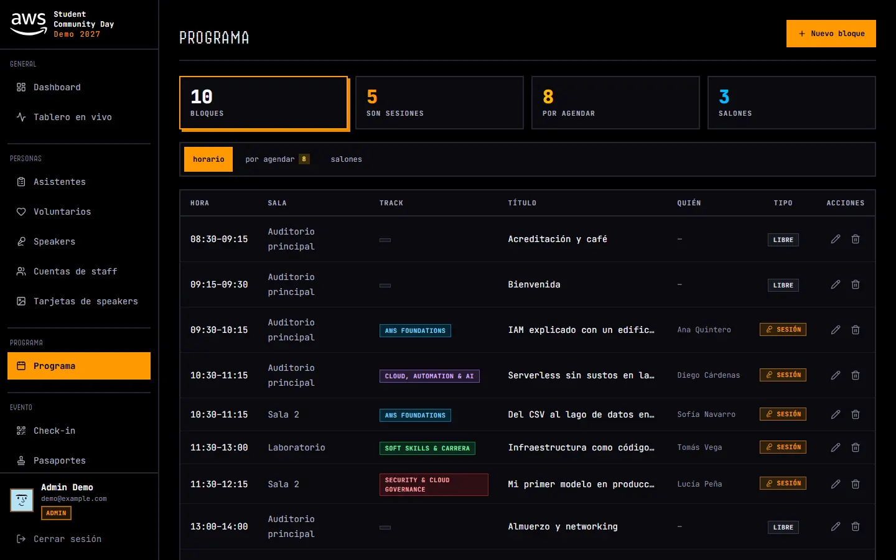 |

### Correos que se editan sin tocar código

Cada correo es una lista de bloques que el equipo edita desde el panel, con
vista previa. Las campañas juntan una plantilla con una audiencia guardada.
Funciona con Resend o con Amazon SES.

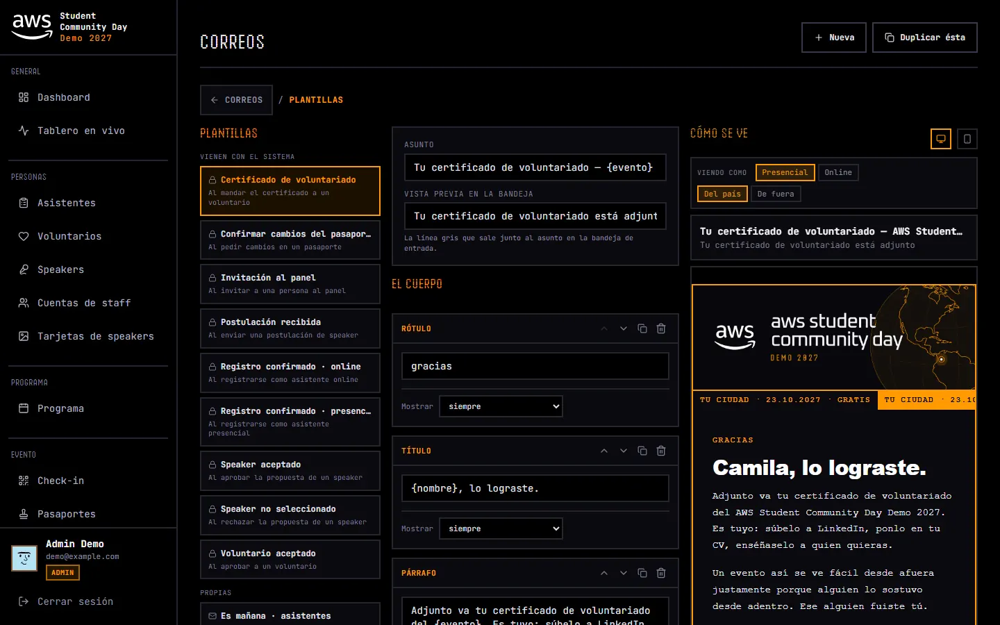

### Más

- **Pasaporte digital**: cada asistente junta sellos de los stands con su QR.
- **Tarjetas de speakers** para redes, generadas con tu tema y editables.
- **Certificados de voluntariado**: el oficial del programa si es un AWS
  Student Community Day, uno con tu tema si es otro Community Day.
- **Legible para máquinas**: `/llms.txt`, `/llms-full.txt`, `/api/evento` y JSON-LD.

### Ocho temas, o el tuyo

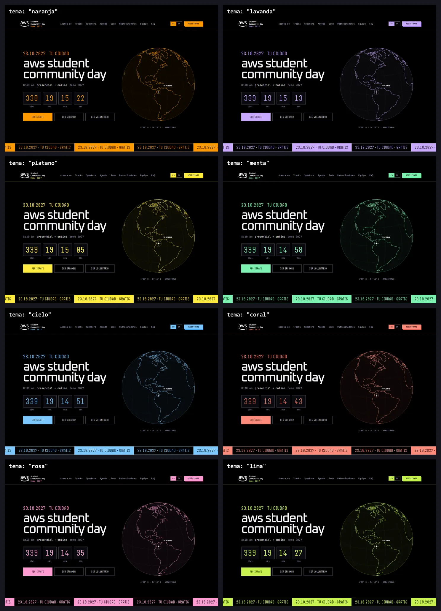

Una línea en la configuración (`tema: "menta"`) o tu propio color
(`tema: "#12AB34"`). Ver [docs/temas.md](docs/temas.md).

## Quién lo usa

| Edición | Sitio |
|---|---|
| AWS Student Community Day Colombia | [awsstudentcommunity.day](https://awsstudentcommunity.day) |
| AWS Student Community Day Chile | [scdchile.cl](https://scdchile.cl) |
| AWS Student Community Day México | [studentcommunitydaymexico.com](https://studentcommunitydaymexico.com/) |

¿Montaste el tuyo con el kit? Abre un PR y súmalo a la lista.

La historia completa, en [Builder Center](https://builder.aws.com/content/3MFNZKPLTc1ZpmmkP4orOqqRDvX/la-plataforma-de-los-student-community-days-ahora-es-de-todos).

## Cómo está armado

```
evento/          tu edición: lo único que editas
public/evento/   tus fotos y logos
src/             el kit
docs/            la documentación
```

| Para | Lee |
|---|---|
| Cada campo de la configuración | [docs/configuracion.md](docs/configuracion.md) |
| Equipo, keynotes, patrocinadores, tracks | [docs/contenido.md](docs/contenido.md) |
| Colores | [docs/temas.md](docs/temas.md) |
| Tu país: documentos, teléfono, ley de datos | [docs/paises.md](docs/paises.md) |
| El panel: roles, permisos y secciones | [docs/panel.md](docs/panel.md) |
| El día del evento: cuentas, red compartida y qué hacer si algo cae | [docs/dia-del-evento.md](docs/dia-del-evento.md) |
| MongoDB Atlas, Amazon DocumentDB, PostgreSQL | [docs/base-de-datos.md](docs/base-de-datos.md) |
| Resend o Amazon SES | [docs/correo.md](docs/correo.md) |
| Publicarlo | [docs/despliegue.md](docs/despliegue.md) |
| Qué protege el kit y qué te toca a ti | [docs/seguridad.md](docs/seguridad.md) |
| Cuando algo falla | [docs/troubleshooting.md](docs/troubleshooting.md) |
| Cómo funciona por dentro | [docs/arquitectura.md](docs/arquitectura.md) · [docs/datos.md](docs/datos.md) |
| Correr las pruebas | [docs/pruebas.md](docs/pruebas.md) |
| De una edición a la siguiente | [docs/nueva-edicion.md](docs/nueva-edicion.md) |
| Todas las capturas | [docs/galeria.md](docs/galeria.md) |

## Para asistentes de IA

El repo está preparado para trabajar con uno:

- [`AGENTS.md`](AGENTS.md): las reglas, los comandos y qué leer según la
  tarea. Claude Code, Codex, Cursor, Copilot, Gemini y Kiro lo cargan solos.
- [`llms.txt`](llms.txt): el índice de la documentación, para un LLM que sólo
  tenga la URL del repo.
- Skills para las tareas que más se repiten (textos, correos, rutas de la API,
  verificar un cambio) en `.claude/skills/` y `.kiro/steering/`.

## Participar

¿Encontraste un error o le falta algo a tu país? Abre un
[issue](https://github.com/heysebitas/aws-community-day-kit/issues/new/choose) o
manda un PR: [CONTRIBUTING.md](CONTRIBUTING.md) lo explica en una página. Los
problemas de seguridad van por privado: [SECURITY.md](SECURITY.md). Lo que
viene está en [ROADMAP.md](ROADMAP.md).

## Licencia

[MIT](LICENSE). Úsalo, cámbialo y móntalo donde quieras.

Este es un proyecto de la comunidad: no es un producto de Amazon Web Services
ni está respaldado por AWS. Las marcas son de sus dueños y el kit no te da
permiso para usarlas; ver [NOTICE.md](NOTICE.md).

Hecho por [Sebastián Acuña](https://github.com/heysebitas), con las mejoras de
[Juan Pablo Bedoya](https://github.com/juan52878911) para abrirlo al público.
