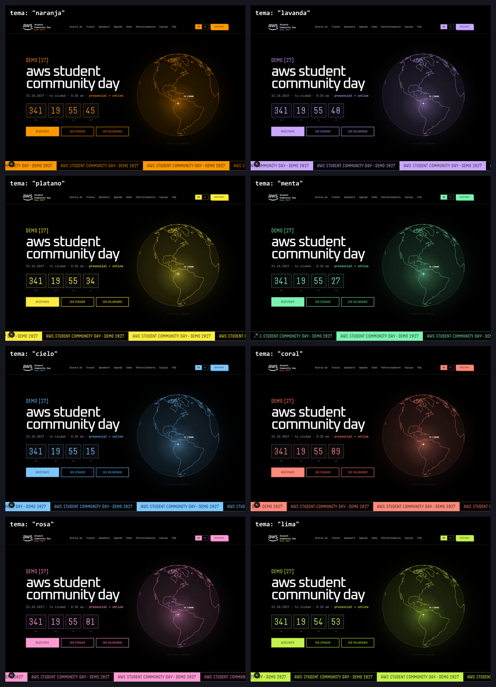

# Temas

El diseño usa un solo color de acento sobre negro. Se elige en `evento/config.ts`:

```ts
tema: "naranja",
```



`naranja` · `lavanda` · `platano` · `menta` · `cielo` · `coral` · `rosa` · `lima`

Para verlos sobre tu propio sitio sin cambiar nada: `npm run demo` y abre
`http://localhost:3000/?tema=menta`.

## Tu propio color

Con un color, el kit deriva los otros tres:

```ts
tema: "#12AB34",
```

El acento es fondo de texto negro, así que un color muy oscuro se aclara hasta
que el texto se lea: un azul marino no va a salir azul marino. Si quieres
control total, pasa los cuatro:

```ts
tema: { acento: "#7CF2B0", claro: "#B8F8D4", fuerte: "#3DDC84", profundo: "#0B5D36" },
```

| Color | Dónde se usa | Regla |
|---|---|---|
| `acento` | Bloques a sangre, botones, acentos sobre negro | 7:1 contra negro |
| `claro` | Estados suaves, hover | |
| `fuerte` | Botón presionado, bordes | |
| `profundo` | Texto y detalles encima del acento | 4.5:1 contra `acento` |

## Añadir un tema al kit

Una línea en `TEMAS` (`src/config/temas.ts`) y su nombre en `NombreTema`
(`src/config/tipos.ts`). `npm test` comprueba los contrastes. Regenera la
imagen con `npm run demo` y `node scripts/hoja-de-temas.mjs`.

## En el código

Nunca un hexadecimal del acento: en CSS, las clases de Tailwind (`bg-acento`,
`text-acento-profundo`, `border-acento-fuerte`); donde no hay CSS —imágenes
generadas, PDF, canvas—, `TEMA` de `@/config`.
